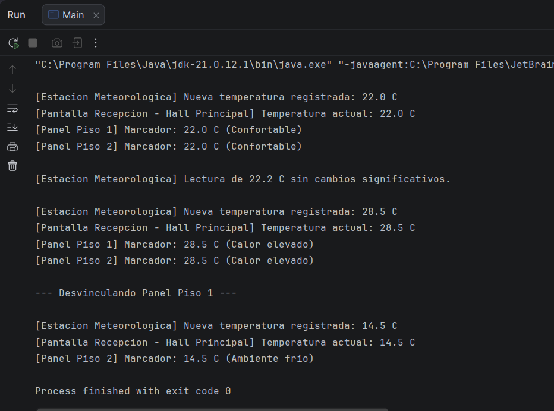

- Diseño de Software - Módulo 4
- Ejercitación 4.E.1 - Patrón Observer
Ejercicio 1: Notificador de Cambio de Temperatura
Contexto del problema:
Una estación meteorológica digital necesita actualizar simultáneamente múltiples pantallas informativas distribuidas en el edificio cada vez que la temperatura ambiente experimenta una variación significativa.

Objetivo de aprendizaje:
Comprender la estructura básica y el propósito fundamental del patrón Observer mediante la relación de uno a muchos entre un sujeto observable y sus observadores dependientes.

Requisitos funcionales:

Permitir registrar y desvincular pantallas u otros dispositivos interesados en recibir los cambios meteorológicos.

Notificar automáticamente a todos los dispositivos suscritos cada vez que se actualice el valor de la temperatura en el sensor principal.

Restricciones técnicas:

El sujeto observable debe mantener una colección interna genérica de observadores sin conocer los detalles de implementación de cada dispositivo visual.

Los observadores deben implementar una interfaz común que declare el método de recepción de la actualización.
***
# Lógica y Funcionamiento del Programa:
    Para resolver este ejercicio apliqué el patrón Observer para desacoplar el sensor principal de las pantallas del edificio, permitiendo sumar o quitar dispositivos visuales sin modificar la estación meteorológica.

- Interfaz Observador: Define el contrato común con el método actualizar(double temperatura) que deben implementar todos los dispositivos que quieran recibir lecturas.

- Interfaz SujetoObservable: Establece los métodos base para gestionar las suscripciones (registrarObservador(), eliminarObservador()) y disparar las notificaciones (notificarObservadores()).

- Clase EstacionMeteorologica: Implementa SujetoObservable y guarda los suscriptores en una lista genérica List<Observador>. Al recibir una nueva medición mediante setTemperatura(), verifica si hubo una variación significativa (al menos 0.5 °C) y, de ser así, recorre la colección avisando automáticamente a todos los observadores activos sin conocer su tipo concreto.

- Clases PantallaRecepcion y PanelPasillo: Son los observadores concretos. Ambos implementan Observador y reaccionan a cada actualización mostrando la temperatura con su propio formato visual.

- Clase Main: En la prueba registré tres pantallas, simulé una lectura inicial, una variación mínima que no dispara avisos, un cambio brusco de temperatura y finalmente desvinculé uno de los paneles para comprobar que deja de recibir notificaciones.
***
# Ejecucion por consola
